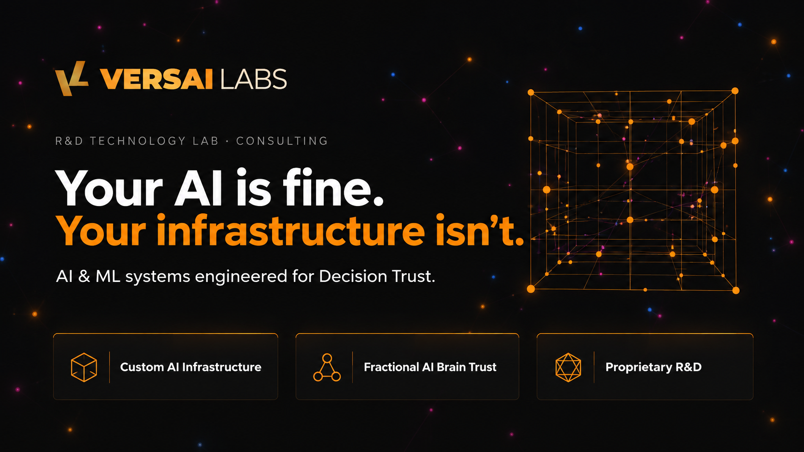
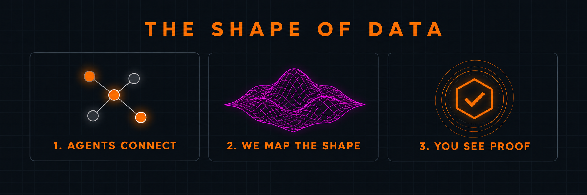

  

# Benjamin Torres

**Founder and CEO of Versai Labs.** I build systems that let you verify what AI agents are doing, and I run my own companies on agents.

I have spent two decades in operations and in Behavior Driven Development (BDD), the practice of writing down how a system should behave in plain language before building it. I use the same discipline on agents: define the behavior, measure it, and check it against evidence.

## Every system has a shape. 

- Our flagship product, DataWell, learns what normal looks like for yours and shows you when that shape changes.
- Agents are part of your system too. DataWell maps how the parts connect and watches for changes.
- Every finding comes from your own data, with the numbers shown, so you can check it.

  

  
## What I am Building

- **DataWell:** a full-body MRI for your systems. Live, in private beta.
- **DataWell AI:** the same idea for AI agents. Agents change as they work, and we show you how, so surprises show up early.
- **Research:** Decision Trust.

## The thesis

Trust in agents is not persuasion. It comes from the math and the facts, built into the system.

## Find me

[VersaiLabs.com](https://versailabs.com) | [getDataWell.com](https://getdatawell.com) | [DataWellAI.com](https://datawellai.com)

DataWell was featured on the Cisco Outshift blog in [AGNTCY in action: How Orium and DataWell are expanding the Internet of Agents](https://outshift.cisco.com/blog/ai-ml/how-orium-and-datawell-expand-internet-of-agents).
